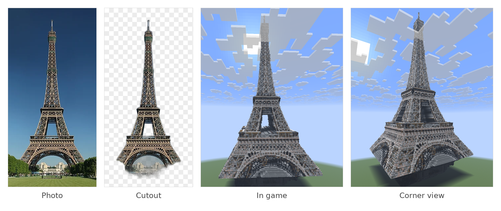
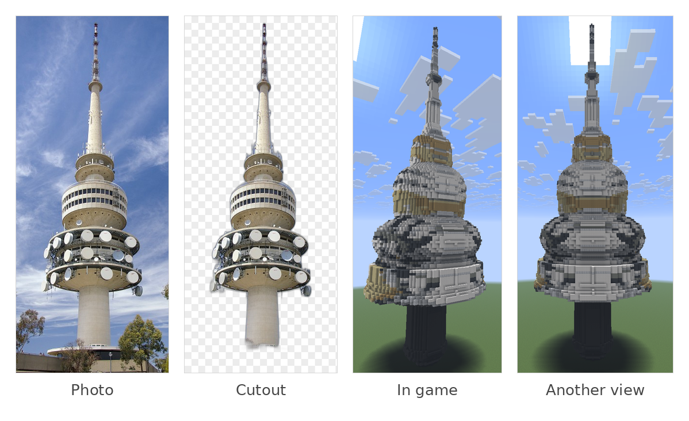
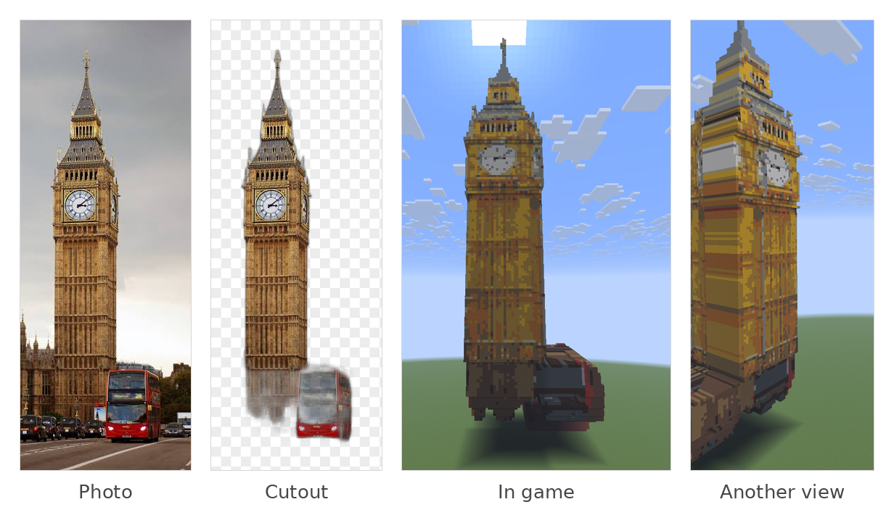

# 🧱 life2craft

📸 ➜ ⛏️ Turns a photo of an object into a Minecraft schematic (`.schem`, for WorldEdit and Litematica). The object can be
anything with a clear outline: a tower, a building, a statue, a bridge.

`📸 photo` ➜ `✂️ cutout` ➜ `🔲 grid` ➜ `🧊 3D` ➜ `🎨 blocks` ➜ `💾 .schem`

## 🗼 Examples

Each figure shows the photo, its cutout, and the build in game. To understand the commands, see
[How it works](#-how-it-works), [Choosing a shape](#-choosing-a-shape), [Usage](#-usage) and [Options](#-options).

### Eiffel Tower

```
python src/main.py data/inputs/eiffel_tower.jpg --height 330 --carve --name eiffel_carve
```

The tower is square, tapers, and looks much the same from all four sides, which is what `--carve` assumes. The side
silhouette is taken to be a copy of the front, so the depth shrinks as the tower narrows (the base is as deep as it is
wide, since no `--depth` is given), the front face slopes back going up, and the gap between the legs stays open.
`--round` would turn it into a round mound, and the default `extrude` would make the spire as deep as the base.
`--height 330` is its real height in metres; at the default 1 m per block that is 330 blocks tall.



The gap between the legs is open and the lattice shows on every face. The arch is still filled in, because the cutout
counts the background seen through it as part of the tower.

### Telstra Tower

```
python src/main.py data/inputs/telstra-tower.jpg --height 195 --round --name telstra_round
```

The shaft and the dish levels are round. `--round` makes every row a filled circle as wide as the silhouette is there,
so the depth at each height equals the width, and the shaft and dish levels come out round and centred on one axis.
`--carve` would make the same tower square. `--height 195` is its real height in metres (about 195 m).



The dishes are not modelled separately: only the outline's width at each height is used.

### Big Ben

```
python src/main.py data/inputs/big_ben.jpg --height 96 --carve --pitch 0.5 --name big_ben_large
```

The Elizabeth Tower is square, tapering and symmetric, so `--carve` fits. With no `--depth`, the base is as deep as it
is wide and each layer above is shallower. At the default 1 m per block it is only about 15 to 20 blocks wide, so each
clock face gets just a few blocks. `--pitch 0.5` makes each block half a metre, which gives a build twice as tall (192
blocks) and gives the clock faces more blocks. A smaller pitch also makes the build much bigger and the run slower.



The cutout kept the bus and a smear under the tower, so the build has a bus-shaped mass at its base. In the second
view the left face comes out grey with horizontal stripes instead of showing the clock. This is a known problem, likely
caused by the bus making the silhouette off-centre.

## ✨ How it works

1. **✂️ Cutout** (`cutout.py`): `rembg` removes the background and saves a transparent PNG. Its alpha channel
   (0 = transparent, 255 = solid) becomes a **mask**: `alpha > 128` is True where a pixel is the subject.
   The mask and photo are then trimmed to the subject's bounding box.
2. **🔲 Grid** (`voxelise.py`): `grid_size` works out how many blocks tall and wide from the real size and the block
   size (`--pitch`). `resample_dominant` then shrinks the photo to one cell per block, giving:
   - `solid`: True where a cell gets a block (more than half of its pixels are subject).
   - `colour`: an RGB colour per cell. **The median** is used here: the median of a cell's pixels (in Lab colour,
     where distance roughly matches how different colours look) finds its dominant shade, and only pixels within
     `threshold` of it are averaged. A few stray pixels, such as blue edge pixels among grey ones, do not tint the
     cell. If there is no clear majority, all the subject pixels are averaged.
3. **🧊 3D** (`voxelise.py`): `extrude`, `revolve` or `carve` turns the 2D grid into 3D (see "Choosing a shape").
   `hollow` then keeps only the blocks that touch air, which makes the file much smaller.
4. **🎨 Blocks** (`match.py`): `match_cells` picks a block for each cell. **K-means** groups the cells' colours into
   `k` groups, so near-identical shades share one material instead of becoming a patchwork. Each group's average
   colour is brightened by `--gain` (Minecraft darkens block faces), then matched to the closest palette block with
   CIEDE2000, a colour-difference measure that matches what the eye sees. Median works inside one cell, and
   k-means works across all the cells.
5. **💾 Export** (`export.py`): writes the `.schem`.

Conventions: x runs left to right across the photo, y is up (row 0 is the ground), and depth runs along z.
In Minecraft, +x is east and +z is south.

## 📐 Choosing a shape

One photo has no depth, so the depth is a guess. The shape flag chooses how to guess it, and `--depth` (metres) sets it
where it applies.

| Flag | What it does | Depth | Good for |
|---|---|---|---|
| none (`extrude`) | pushes the silhouette straight back | `--depth` at every height (default: as wide as the grid) | houses, signs, bridges, anything flat or boxy |
| `--round` (`revolve`) | makes each row a filled circle as wide as the silhouette there | equal to the width at each height; `--depth` is ignored | round objects: water towers, columns, vases, tree trunks |
| `--carve` | keeps a block only where the front and side silhouettes are both solid, with the side taken as a copy of the front | `--depth` sets the widest layer; narrower layers get less, equal to their width | square objects that taper and look the same from the side: the Eiffel Tower, pylons, pyramids |

`--carve` makes depth shrink with width, so the front face slopes back going up, gaps in the silhouette (such as
between the Eiffel Tower's legs) stay open, and all four faces show the photo. `--round` fills gaps, because each
circle is solid across its full width. There is no relief: windows, arches and clock faces are painted on with
colour, not carved in.

## 🚀 Usage

Run from the project root. The file names below are illustrative.

```
# a round object
python src/main.py data/inputs/telstra_tower.jpg --height 195 --round

# a square tapering tower
python src/main.py data/inputs/eiffel_tower.jpg --height 330 --carve

# a boxy building, with its depth given
python src/main.py data/inputs/house.jpg --height 5.5 --depth 14 --pitch 0.25

# giving the width instead of the height
python src/main.py data/inputs/eiffel_tower.jpg --width 125 --carve
```

`main.py` builds one photo per run. To cut out several photos at once (transparent PNGs only, no schematics), use
the cutout script directly:

```
python src/cutout.py data/inputs/a.jpg data/inputs/b.jpg --out my_cutouts
```

The schematic is written to `output/<name>.schem`, and the cutout to `data/crop_outputs/`.
In game: copy the `.schem` into the WorldEdit `schematics` folder, then run `//schem load <name>` and `//paste`.

## ⚙️ Options

| Option | Point | Default |
|---|---|---|
| `photo` | the photo to build from. Positional (no dashes) and goes first | required |
| `--height`, `--width` | real size in metres; this sets the scale. Give one or both; the other is worked out from the photo's proportions | one is required |
| `--depth` | metres front to back, for `extrude` and `--carve` (ignored with `--round`) | as wide as the grid |
| `--round` | spin the silhouette into a round object | off |
| `--carve` | square object with the same silhouette on all four sides (not with `--round`) | off |
| `--pitch` | metres per block. Smaller means more detail and a much bigger build | 1 |
| `--colours` | `k` for k-means: the number of colour groups. Fewer is cleaner, more keeps detail | 12 |
| `--gain` | brightening to make up for Minecraft's face shading (about 0.7 on average). Raise it if a build looks too dark in game | 1.4 |
| `--solid` | fill the inside | hollow shell |
| `--version` | Minecraft Java version of the file, e.g. `JE_1_20_1` | `JE_1_20_1` |
| `--name` | schematic name | the photo's file name |
| `--out` | output folder | `output` |

## 🛠️ Setup

```
python -m venv .venv
.venv\Scripts\Activate.ps1        # macOS/Linux: source .venv/bin/activate
python -m pip install -r requirements.txt
```

The first run downloads the cutout model (about 176 MB). Windows and Linux install the GPU build of onnxruntime,
which falls back to the CPU if no GPU is set up. macOS installs the CPU build.

## 📁 Layout

```
src/cutout.py       rembg cutout (one or several photos)
src/voxelise.py     grid size, resampling (median), extrude / revolve / carve / hollow
src/match.py        k-means grouping and block matching
src/export.py       .schem writer
src/main.py         command line, one photo per run
data/palette.json   block name -> average RGB (46 blocks; all exist in every version since 1.16)
data/inputs/        source photos
```

Add a block by adding `"minecraft:name": [r, g, b]` to `palette.json`.

## ⚠️ Limits

- Depth comes from `--depth`, not the photo; if omitted it defaults to the grid's width. `--carve` also assumes the
  side silhouette is the same as the front.
- One photo per object: there are no side or back views, and `main.py` builds one photo per run.
- The cutout model picks the most noticeable object, so it can pick the wrong one in a cluttered photo, and it can
  count background seen through gaps (such as the Eiffel Tower's arch) as part of the subject.
- No windows or glass, and no sloped roofs.
